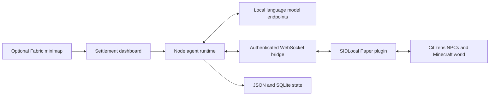

# Architecture and source map

| Directory | Purpose |
|---|---|
| `agent-core/` | Runtime loop, dashboard, citizen roles, town life, cognition, construction, economy and skills |
| `node-bridge/` | Node client for the authenticated Minecraft bridge |
| `server-plugin/` | Paper plugin source, Gradle wrapper, resources and policy tests |
| `client-mod/` | Fabric minimap, GPS, citizen feed, terrain cache and tests |
| `config/` | Schemas, citizen/world plans and credential-free configuration examples |
| `scripts/` | Setup, diagnostics, backup, restore, model probes and simulations |
| `systemd/` | Runtime, backup, watchdog and port-filter services/timers |
| `tests/` | Node regression tests |
| `audit/` | Historical audit documentation; findings are dated observations |
| `docs/verification/` | Sanitized verification summaries with explicit limits |
| `archive/original-prototype/` | Original early implementation, superseded by the current runtime |
| `archive/maintenance-2026-10-09/` | One-time inspection and supervised world-maintenance tools |

Core state is persisted outside the source checkout. Bank account balances, conversations, NPC memories, build progress and live world edits are runtime data, not public source configuration.

The maintenance tools can move NPCs, place blocks, and modify persisted state. They reference specific deployment paths and require credentials supplied through the environment. Read and adapt them, stop conflicting runtime work where required, and back up the world before using them. They are preserved as operational history, not automatically run during installation.
