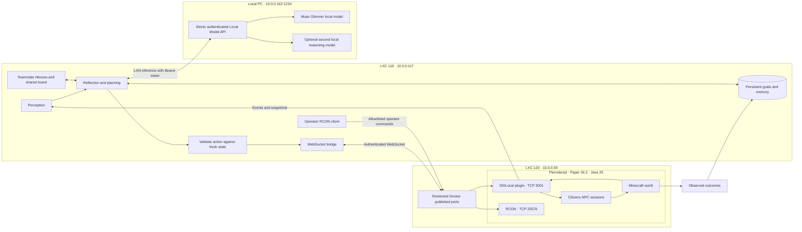

> Historical setup and incident notes. Start with [the current README](../README.md) and [current deployment guide](DEPLOYMENT.md).

# 1. LXC 119 Fixes

**Confirmed root cause: Minecraft protocol incompatibility, not blocked Node.js networking.** Inspected live on September 25, 2026. The replacement below uses a Citizens plugin bridge and therefore does not depend on Mineflayer supporting Minecraft 26.2.

| Live check | Observed result |
|---|---|
| Proxmox | VE 9.2.20 |
| LXC 119 | Ubuntu, Node.js v22.23.3, IP 10.0.0.117 |
| Route to Minecraft | `10.0.0.58 dev eth0 src 10.0.0.117` |
| Node TCP connection to 25565 | OPEN |
| Original application | Mineflayer 4.39.0, hardcoded `version: '1.21'`, `pingServer: false` |
| Server | Paper 26.2-129, Minecraft 26.2, Java 25 |
| Explicit Mineflayer 26.2 probe | `unsupported protocol version: 26.2` |
| Plugin port 3001 | ECONNREFUSED; absent from Minecraft Docker port mappings |
| Port 25575 | Already allocated to a different game container; do not reuse |
| Bionic at 10.0.0.162:1234 | Reachable; requires Bearer API token |
| Advertised 100.72.143.83:1234 | Connection refused from LXC 119 |

**Exact lines to add to `/etc/pve/lxc/119.conf`: none are justified by the observed fault.** These relevant lines already exist; retain them, and do not append duplicate keys:

```ini
features: nesting=1
net0: name=eth0,bridge=vmbr0,firewall=1,hwaddr=BC:24:11:BF:CE:E8,ip=dhcp,type=veth
```

Reserve DHCP address **10.0.0.117** for this MAC in your DHCP server because the port restrictions below use it. Do not guess a static gateway or replace the current address configuration.

* AppArmor: the sampled denials concerned **LXC 120 rsyslog and `/run/systemd/journal/dev-log`**, not LXC 119 outbound TCP. This does not establish an absence of all possible denials, but the successful Node TCP test rules out a blanket block on the tested connection.
* `lxc.apparmor.profile: unconfined`: unnecessary for this repair. Do not add it.
* `lxc.cap.drop:`: clearing capability restrictions is unnecessary for ordinary TCP clients. Do not add it.
* `nesting=1`: already enabled; ordinary Node.js networking does not need Docker nesting.
* Routing: 119 and 120 communicate directly on their LAN. No inter-LXC NAT rule is required.
* IPv6/DNS: the failed application uses a literal IPv4 address. Disabling IPv6 or changing DNS cannot fix its protocol mismatch.

[Proxmox documents the security impact of disabling AppArmor and enabling nesting](https://pve.proxmox.com/pve-docs-9-beta/pct.1.html). Preserve isolation and test the actual application path.

Run the supplied read-only diagnostic script on the Proxmox host:

```bash
bash scripts/diagnose-proxmox.sh
```

The optional `scripts/legacy-bot.cjs` provides bounded reconnects and an explicit unsupported-protocol exit for the old application. It **does not** supply missing protocol support. The functional replacement is `agent-core/main.mjs` plus the plugin below. Do not downgrade an existing 26.2 world into 1.20.6. A 1.20.6 build is included only for a separate, compatible server/world.

# 2. Pterodactyl Networking Fixes

The Minecraft container is:

```text
957838a4-67e6-4c59-a2fc-94c92e984c2a
```

Its host directory inside LXC 120 is:

```text
/var/lib/pterodactyl/volumes/957838a4-67e6-4c59-a2fc-94c92e984c2a
```

Observed mappings expose only `10.0.0.58:25565` TCP/UDP for Minecraft. In **Pterodactyl Admin → Nodes → your Wings node → Allocations**, create `10.0.0.58:3001` and `10.0.0.58:25576`, then assign both as additional allocations to this Minecraft server. Keep 25565 as primary. Stop/start this server through the panel so Wings applies the mappings. Do not restart every game server or remove `pterodactyl_nw`.

| Port | Purpose | Who needs access |
|---|---|---|
| TCP 25565 | Minecraft clients/status | Existing intended players |
| TCP 3001 | Authenticated SIDLocal WebSocket | 10.0.0.117 only |
| TCP 25576 | Optional authenticated Minecraft RCON | 10.0.0.117 only |
| TCP 1234 on 10.0.0.162 | Bionic local model API | 10.0.0.117 and intended local clients |

The plugin must bind **0.0.0.0 inside Docker**, not the host's LAN IP. Keep Docker bridge networking; host networking is unnecessary. [Pterodactyl allocations documentation](https://pterodactyl.io/wings/1.0/installing) and [network-mode guidance](https://pterodactyl.io/wings/1.0/configuration.html).

Inside LXC 120, existing configuration already has:

```text
net.ipv4.ip_forward = 1
-A POSTROUTING -s 172.17.0.0/16 ! -o docker0 -j MASQUERADE
-A POSTROUTING -s 172.18.0.0/16 ! -o pterodactyl0 -j MASQUERADE
```

**No additional MASQUERADE rule is needed.** Inbound published-port traffic needs the Pterodactyl allocation/Docker DNAT mapping, not another blanket NAT rule.

Install the provided narrow port filter **inside LXC 120** after Docker is running and before starting the bridge:

```bash
install -m 0755 scripts/restrict-bridge-ports.sh /usr/local/sbin/restrict-bridge-ports
install -m 0644 systemd/sid-port-filter.service /etc/systemd/system/sid-port-filter.service
systemctl daemon-reload
systemctl enable --now sid-port-filter.service
```

It uses `DOCKER-USER` and original destination matching, allows only 10.0.0.117 to these two ports, and preserves unrelated rules. [Docker's firewall documentation](https://docs.docker.com/engine/network/firewall-iptables/) explains why published ports need forwarding-chain filtering. It assumes the observed iptables backend; do not apply it unchanged after switching Docker to an nftables-only backend.

If Proxmox or guest firewall policy separately drops inbound traffic, add narrow allow rules for source `10.0.0.117/32`, destination `10.0.0.58`, TCP ports `3001,25576` before its default drop. Keep all other policy intact. No router/WAN port forwarding is required.

For optional RCON, edit these keys in the Minecraft server's existing `server.properties` (preserve all other settings):

```properties
enable-rcon=true
rcon.port=25576
rcon.password=REPLACE_WITH_A_SEPARATE_RANDOM_PASSWORD
broadcast-rcon-to-ops=false
```

Generate the password with `openssl rand -hex 32`, then put the same value in `RCON_PASSWORD` on LXC 119. RCON and this LAN WebSocket endpoint are not encrypted; source restrictions and a trusted LAN are required. Use a private tunnel if carrying them across untrusted networks. Never give the LLM arbitrary RCON commands.

# 3. Node.js Connection Code

Complete runnable sources are in `node-bridge/bridge.mjs`, `package.json`, `package-lock.json`, and `config/world.schema.json`. `FULL-GUIDE.md` embeds their entire contents, along with all other source files.

The WebSocket client provides:

* Bearer authentication, heartbeat/pong checks, exponential reconnect with jitter.
* Per-agent session registration and event subscription restored after reconnect.
* Request IDs, acknowledgement timeouts, and explicit rejection of pending operations on disconnect.
* No automatic replay of uncertain actions; a lost acknowledgement must not duplicate an attack or lever toggle.
* Schema-validated snapshots, bounded pending requests, and fresh-state checks after inference.

The operator-only RCON wrapper permits `list`, `version`, and `time query daytime`. It serializes calls, reconnects on the next request after failure, and is optional for the agent loop. WebSocket/Citizens provides actual agent control.

Protocol examples (the client supplies a unique `id`):

```json
{"type":"subscribe","id":"request-1","events":["chat","movement","block","entity","action"]}
{"type":"session","id":"request-2","agent":"scout"}
{"type":"action","id":"request-3","agent":"scout","action":{"type":"pathfind","x":268.5,"y":69,"z":99.5}}
```

Success responses are `{"type":"ack","id":"...","ok":true,"result":...}`; errors set `ok:false` and `error`. A movement acknowledgement means navigation was requested, **not** that the destination was reached. Snapshots drive progress/arrival evaluation.

# 4. PaperMC Plugin (Full Source)

Complete Java source: `server-plugin/src/main/java/local/sid/SIDLocal.java`. Gradle build, wrapper, `plugin.yml`, and default configuration are included. The prebuilt shaded JARs are:

* `dist/SIDLocal-2.13.0.jar`: the plugin running on the server now (Java 25, Paper 26.2, Citizens 2.0.44). It is the shaded build of `server-plugin/` at version 2.13.0 (`server-plugin/build.gradle`); rebuild it with step F and copy `server-plugin/build/libs/SIDLocal-<version>.jar` here. **On the server it is always installed as `plugins/SIDLocal.jar`** - replace that one file; never put a second SIDLocal jar beside it (two copies load twice and fight over port 3001).
* `dist/obsolete/`: the 1.x prebuilt jars (`SIDLocal-Paper26.2.jar`, `SIDLocal-Paper1.20.6.jar`) - kept for reference only; they lack everything since plugin 2.0 and must not be deployed.

The plugin requires Citizens, which your current server already has. Citizens is compile-only and is not bundled into the JAR. Java-WebSocket and Gson are shaded/relocated. [Citizens API integration](https://wiki.citizensnpcs.co/API), [navigation API](https://jd.citizensnpcs.co/net/citizensnpcs/api/ai/Navigator.html), and [Paper Java version requirements](https://docs.papermc.io/paper/getting-started/).

Implemented actions:

| Action | Implementation |
|---|---|
| `move`, `pathfind` | Citizens navigation to absolute coordinates, at most 24 blocks per request |
| `wait` | Cancel navigation |
| `chat` | Literal local chat within 64 blocks; no console execution |
| `interact` | Toggle a door, gate, trapdoor, or lever within 4 blocks |
| `attack` | Request 2 damage to a visible non-player entity within 3 blocks; server events can cancel it |

World access and NPC operations run on the Paper main thread. The WebSocket thread authenticates and enqueues bounded requests. The server enforces agent ownership, an allowlist, request/action limits, world boundaries, loaded chunks, and a bounded roaming radius. Snapshots arrive once per second with agent position, health, navigation state, nearby entities, and nearby non-air blocks. Player chat/movement, block placement/breaking, entity spawn/death/damage, and agent actions are streamed.

NPC skin fetching is disabled for these NPCs. Agents use a private in-memory Citizens registry and are removed on shutdown or after 60 seconds disconnected. They stop navigating on disconnect. Reconnecting within that grace period reclaims the existing NPC; a full plugin restart respawns it at configured spawn. Cognitive memory persists in Node, but NPC position is not persisted across plugin restart.

**Scope:** these are player-shaped Citizens NPCs, not authenticated player accounts or full survival bots. Inventory, crafting, mining, building, trading, and arbitrary right-click semantics are not implemented. Interaction directly changes supported block states and is intended for an operator-owned simulation area; it does not emulate a player's protection-plugin interaction event. This is a complete implementation of the listed action set, not a reproduction of all Project SID research capabilities.

# 5. Agent Architecture

```text
/opt/sid-local/
├── agent-core/
│   ├── main.mjs              # fair sequential scheduler and five-stage loop
│   ├── lm.mjs                # local inference, model roles, optional model load
│   ├── actions.mjs           # strict schemas and action bounds
│   └── memory.mjs            # persistent goals, episodic memory and teammate inboxes
├── node-bridge/
│   └── bridge.mjs            # WebSocket and optional operator RCON
├── server-plugin/
│   ├── build.gradle
│   ├── settings.gradle
│   ├── gradlew / gradlew.bat
│   ├── gradle/wrapper/
│   └── src/main/
│       ├── java/local/sid/SIDLocal.java
│       └── resources/{plugin.yml,config.yml}
├── config/
│   ├── agents.json
│   ├── runtime.env.example
│   └── world.schema.json
├── scripts/
│   ├── configure.sh
│   ├── install.sh
│   ├── restart.sh
│   ├── models.mjs
│   ├── check.mjs
│   ├── action.mjs
│   ├── events.mjs
│   ├── diagnose-proxmox.sh
│   ├── restrict-bridge-ports.sh
│   └── legacy-bot.cjs
├── systemd/{sid-local.service,sid-port-filter.service}
├── tests/runtime.test.mjs
├── dist/{SIDLocal-2.13.0.jar,obsolete/}
├── package.json
└── package-lock.json
```

Per agent:

1. **Perception:** consume a validated fresh snapshot plus bounded recent events.
2. **Reflection:** produce a short operational summary informed by recent memory and prior action results.
3. **Planning:** choose one feasible step toward a persisted goal.
4. **Action:** revalidate against the newest world state, dispatch, and record the acknowledgement or error.
5. **Self-evaluation:** on the next cycle, compare the requested position with observed position and record arrival/progress. Acknowledgements for other actions remain acknowledgements, not unverified goal-success claims.

Agents have separate memory, personalities and goals, plus bounded teammate inboxes and a shared message board. The `tell` action delivers a message to another configured agent. A single fair loop serializes inference to avoid overloading the local model; multiple NPCs can navigate at the same time. No cross-process distributed scheduler or 1,000-agent scaling is claimed.

Goals initially come from `config/agents.json`, then persist in `/var/lib/sid-local/memory.json`. To change an existing persisted goal, stop the service, edit that agent's `goal` in memory.json, and restart. New agents must be added both to agents.json and the plugin allowlist. Maximum default is eight. The sample "builder" surveys and coordinates; it does not have building tools.

# 6. LM Studio Integration Code

**Bionic is the application/agent harness, not a model named `bionic`.** Muse Glimmer is a model supported by Bionic. [Bionic documentation](https://lmstudio.ai/docs/bionic), [Muse Glimmer local API instructions](https://lmstudio.ai/blog/muse-glimmer).

Use the endpoint verified reachable from LXC 119:

```dotenv
LM_BASE_URL=http://10.0.0.162:1234
LM_API_TOKEN=YOUR_EXISTING_LOCAL_API_TOKEN
REASON_MODEL=EXACT_LOCAL_MODEL_ID
DIALOG_MODEL=EXACT_LOCAL_MODEL_ID
LM_AUTO_LOAD=false
```

Do **not** include `/v1` in `LM_BASE_URL`. The client adds `/v1/models` and `/v1/chat/completions`. The 100.72.143.83 address advertised by Bionic did not work from LXC 119 during inspection. This is not a reason to disable API authentication.

In Bionic on 10.0.0.162:

1. Download/select the **local** Muse Glimmer model in Settings → Explore. Confirm it fits available memory and is not a cloud-backed selection.
2. Enable Settings → Local Model API. Keep token authentication enabled. Copy an existing token locally into the configuration prompt; do not paste it into chat.
3. Keep the current LAN listener, which already answers from LXC 119. If Windows Firewall needs a rule after a future change, use an inbound TCP 1234 rule restricted to 10.0.0.117; no broad/public rule is needed.
4. Query model IDs from LXC 119 after configuring the token:

```bash
cd /opt/sid-local
node --env-file=config/runtime.env scripts/models.mjs
```

Set both roles to the exact returned Muse Glimmer ID to use one loaded model for reasoning and dialogue. You may select a second locally downloaded reasoning model, but there is no fabricated "Bionic model" to load. Requests differ by prompt and temperature. No cloud fallback, external tools, or automatic model downloads are present.

`agent-core/lm.mjs` also implements optional model loading. If your local server supports LM Studio's native v1 management API, set `LM_AUTO_LOAD=true` and supply **model keys** to the role variables; it calls `/api/v1/models/load` and uses each returned `instance_id`. For servers exposing only OpenAI-compatible endpoints, leave this false and preload models through the UI or `lms load`. [Model loading API](https://lmstudio.ai/docs/developer/rest/load).

The client uses JSON-schema output by default. If a model/server rejects that feature, set `LM_STRUCTURED=false`; responses are still parsed and validated, and malformed plans never reach Minecraft. If two models do not fit simultaneously, use one model ID for both roles. Inference has a timeout and runs one request at a time.

# 7. Deployment Steps

These are prepared deployment instructions. The live checks above did **not** install the plugin, change firewall policy, disable AppArmor, or supply your LM token. Full in-game validation remains to be performed after deployment.

**A. Prepare LXC 119.** Copy the delivered `sid-local.tar.gz` to `/tmp/sid-local.tar.gz` in LXC 119 using your normal SSH/SFTP method. Then run inside LXC 119:

```bash
sudo -i
install -d /opt/sid-local
tar -xzf /tmp/sid-local.tar.gz -C /opt/sid-local --strip-components=1
cd /opt/sid-local
node --version
npm --version
bash scripts/configure.sh
npm ci --omit=dev --ignore-scripts
node --env-file=config/runtime.env scripts/models.mjs
nano config/runtime.env
bash scripts/install.sh
```

Node 22.23.3 is already installed on this container, so no Node installation is needed. On a fresh machine, install Node 22 or newer from the official Node distribution or your distribution's maintained package source first. `install.sh` creates a dedicated service user and does not start the service before configuration.

`configure.sh` creates a random shared bridge token in runtime.env and `config/plugin-config.yml`. It prompts for the existing Bionic token without echo. It refuses to overwrite existing files. Set the exact model IDs after listing them. Leave RCON_PASSWORD blank if not enabling RCON. Never commit generated secret files.

**B. Install the plugin in LXC 120.** Stop only this Minecraft server through Pterodactyl first. Copy `dist/SIDLocal-2.13.0.jar` (or the newest `server-plugin/build/libs/SIDLocal-<version>.jar`) and the generated `config/plugin-config.yml` into `/tmp` in LXC 120, naming the latter `/tmp/sid-plugin-config.yml`. Then, inside LXC 120:

```bash
server_dir=/var/lib/pterodactyl/volumes/957838a4-67e6-4c59-a2fc-94c92e984c2a
install -d -o 999 -g 988 -m 0750 "$server_dir/plugins/SIDLocal"
install -o 999 -g 988 -m 0644 /tmp/SIDLocal-2.13.0.jar "$server_dir/plugins/SIDLocal.jar"
install -o 999 -g 988 -m 0640 /tmp/sid-plugin-config.yml "$server_dir/plugins/SIDLocal/config.yml"
```

UID 999/GID 988 are the container's observed runtime IDs **inside LXC 120**; do not use these on the Proxmox host's id-mapped filesystem. Existing Citizens 2.0.44 remains installed; no Sentinel dependency is needed. Choose a clear, safe spawn area in config.yml. By default the plugin uses the world's spawn; the sample coordinates are ignored unless `configured-spawn: true`.

**C. Configure networking.** Add/assign allocations 3001 and optionally 25576, configure RCON if wanted, and install the narrow filter as described in section 2. Start the Minecraft server through Pterodactyl. Confirm the log contains `SIDLocal listening` and no plugin exceptions. Do not use `/reload`.

Verify inside LXC 120:

```bash
docker port 957838a4-67e6-4c59-a2fc-94c92e984c2a
docker logs --tail 80 957838a4-67e6-4c59-a2fc-94c92e984c2a
```

**D. Check and run the agent runtime in LXC 119:**

```bash
cd /opt/sid-local
npm test
npm run check
sudo systemctl enable --now sid-local.service
sudo journalctl -u sid-local.service -f
```

`npm run check` performs real inference and creates a temporary scout session to verify snapshots; run it with the main service stopped to avoid session ownership conflicts. It does not move or attack. After disconnect, its NPC is removed after 60 seconds or reclaimed by the main runtime.

Leave the old `/opt/minecraft-bot` files intact as a backup. Stop its old foreground reconnect loop with Ctrl+C in its actual terminal, or stop its identified service if later configured. The new service does not invoke Mineflayer and should be the only autonomous runtime.

**E. Logging and recovery:**

```bash
sudo journalctl -u sid-local.service --since '-15 minutes' --no-pager
sudo systemctl status sid-local.service --no-pager
sudo bash /opt/sid-local/scripts/restart.sh
```

systemd restarts crashes after 10 seconds, with a start-rate limit to avoid restart storms. WebSocket outages reconnect within the runtime. Model errors are logged and the loop retries on later cycles; no cloud fallback is used. Memory is atomically replaced in `/var/lib/sid-local/memory.json` and capped at 40 episodes per agent. Journald's system retention policy manages service logs.

Rollback: stop/disable `sid-local`, stop Minecraft through Pterodactyl, move only `plugins/SIDLocal.jar` out of plugins, and start Minecraft. Remove the two added allocations and specifically the SID port rules if abandoning the deployment. Do not delete worlds, Citizens data, or flush firewall tables. The plugin's private NPC registry does not modify existing Citizens NPCs.

**F. Build from full source:** install JDK 25, then:

```bash
cd /opt/sid-local/server-plugin
bash gradlew build
# Output: build/libs/SIDLocal-<version>.jar (shaded; version from build.gradle, now 2.13.0)
# Install it on the server as plugins/SIDLocal.jar (replace the file; see "Updating a running server" in DEPLOY-NOW.md).
```

The optional separate 1.20.6 target:

```bash
bash gradlew build -PpaperApi=1.20.6-R0.1-SNAPSHOT -PcitizensVersion=2.0.35-SNAPSHOT -PjavaRelease=21
```

Build dependencies and model weights require initial downloads. After installation, agent inference and control use local endpoints only. The distribution includes the compiled JARs, so Gradle/JDK are not needed in LXC 119 for normal operation.

# 8. Test Plan

**Validation completed during preparation:** live TCP/routing and endpoint checks in section 1; successful shaded builds for Paper 26.2 and 1.20.6; six passing Node tests covering invalid actions, persistent memory/teammate messages, WebSocket reconnect/session restoration, local model role routing/authentication, RCON command restriction, and RCON authentication/dispatch/reconnect; npm audit reported zero vulnerabilities for the pinned Node dependency tree. Java compilation does not prove live Paper behavior. LM and RCON integration tests used local stubs and do not prove real Muse Glimmer inference or a live Minecraft RCON listener. No in-game autonomy success is claimed yet.

Deployment acceptance checks, in order:

| Check | Method | Pass criterion |
|---|---|---|
| 119 → Paper TCP | `npm run check` | Minecraft TCP PASS |
| Docker publication | `docker port` in 120 | 3001 and selected RCON port map to the Minecraft container |
| Authentication | Connect once with wrong bridge token | Handshake rejected; no NPC spawned |
| Sessions/snapshots | `npm run check` with service stopped | scout snapshot received |
| LM inference | Same check, real token and local model | Nonempty inference response |
| RCON | Configure password and run check | `list` response; another game's port is never used |
| World events | Start service, chat, walk, place/break a test block, spawn an entity | Relevant events visible to the agent loop; block/entity data in snapshots |
| Chat action | Use manual command below, service stopped | Nearby player sees `[scout] Hello from SIDLocal` |
| Navigation | Use a clear destination within 24 blocks in the same world | NPC visibly walks; later snapshot reaches destination within 2 blocks |
| Interaction | Place a lever within 4 blocks; issue interact | Lever toggles; distant/unsupported blocks rejected |
| Attack | Use a test hostile mob within 3 blocks and line of sight | Damage event observed; players and distant targets rejected |
| Coordination | Run scout and builder | `tell` actions create recipient inbox entries and affect later planning |
| Recovery | Restart Node; then restart Minecraft normally | Memory survives, sessions reestablish, NPC count stays bounded |
| Isolation | Try 3001/25576 from a different LAN host | Denied; 119 continues to work |
| LXC policy | Correlate host audit logs while tests run | No relevant denials for required operations; AppArmor remains enabled |

Manual action example in LXC 119, with the main service stopped:

```bash
cd /opt/sid-local
node --env-file=config/runtime.env scripts/action.mjs scout '{"type":"chat","text":"Hello from SIDLocal"}'
```

For movement/interactions, replace coordinates below with positions you have verified in the actual world. These sample coordinates were a player's earlier location, not a guarantee of safe current terrain:

```bash
node --env-file=config/runtime.env scripts/action.mjs scout '{"type":"pathfind","x":268.5,"y":69,"z":99.5}'
```

For movement, the action client remains connected for up to 30 seconds, prints observed distance, and reports `ARRIVED` only after a snapshot places the NPC within two blocks of the target. It then disconnects. A timeout fails the test and the plugin cancels navigation on disconnect. The destination must be within 24 blocks of the configured NPC spawn/current location.

To observe subscribed world events alongside the main runtime without claiming its NPCs:

```bash
node --env-file=config/runtime.env scripts/events.mjs
```

Do not interpret “no restrictions remain” as disabling all LXC isolation. The required result is **all required operations pass while unrelated protections remain active**.

# 9. Final Combined System Diagram


